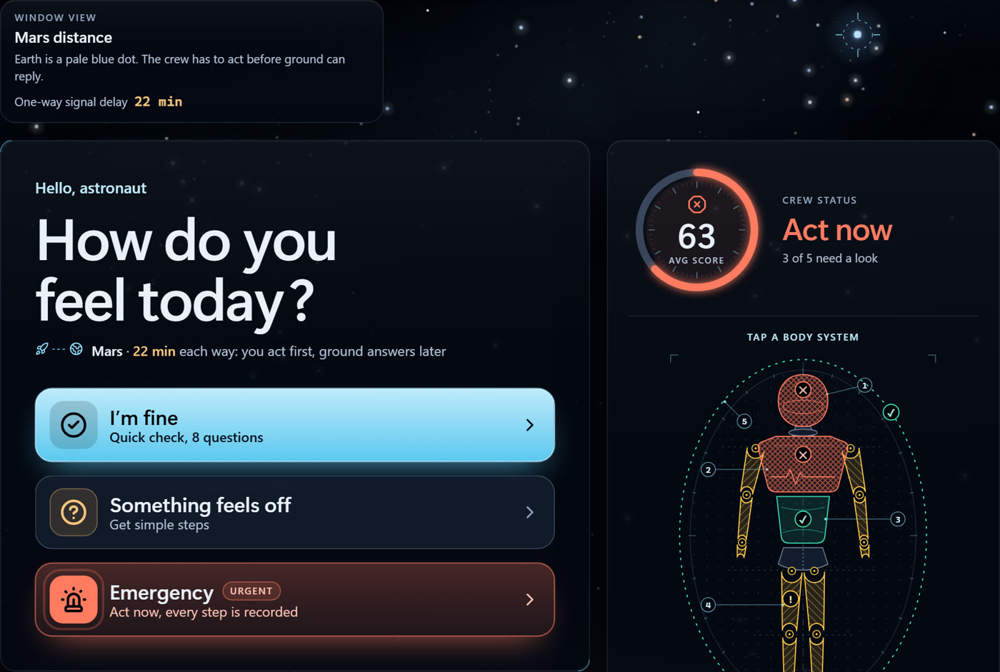
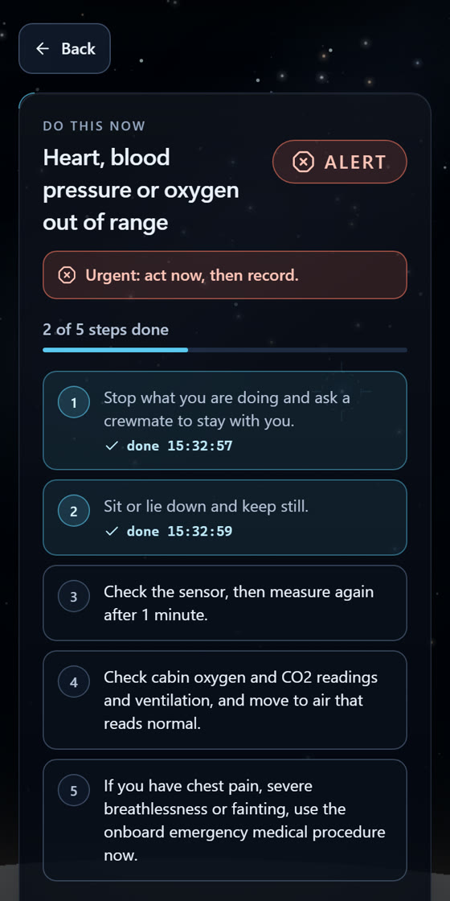
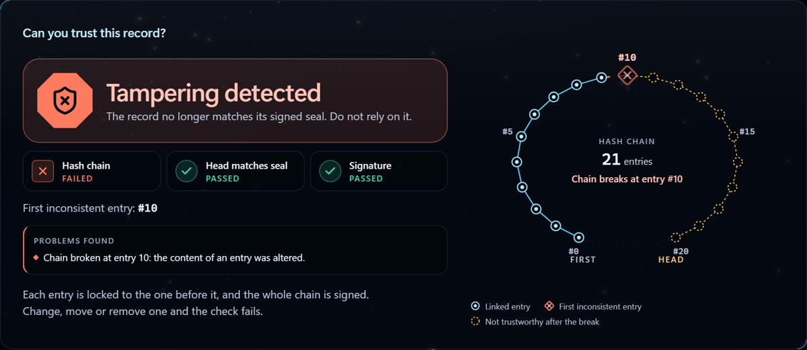
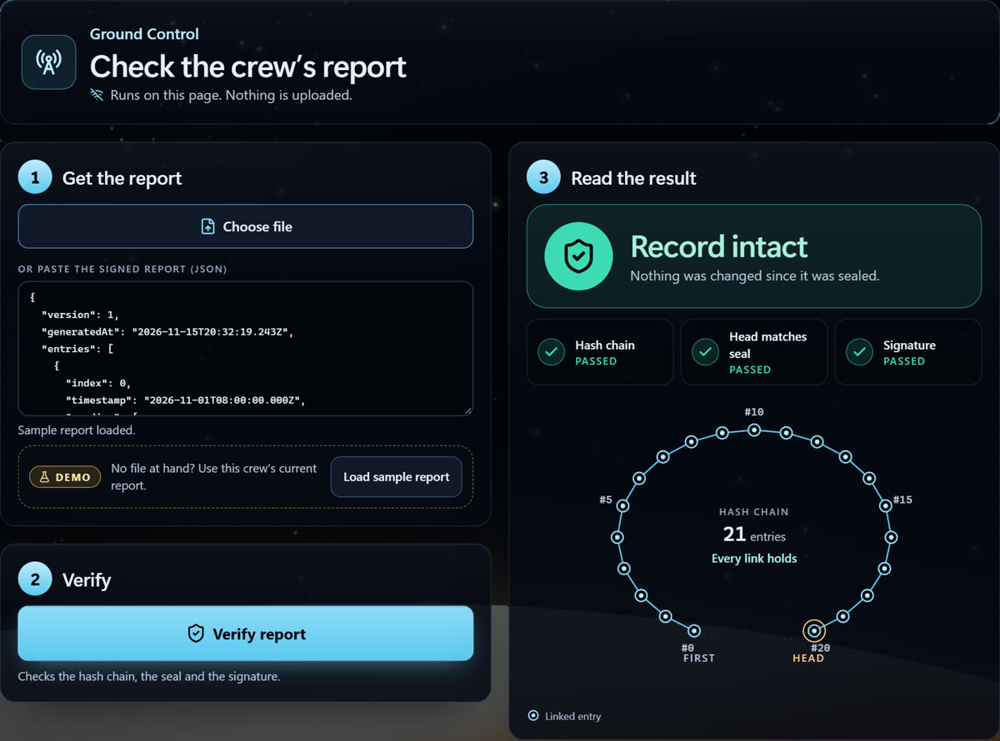

# VitalSeal

**Offline-first health monitoring for astronauts, with records that show they were not altered.**

NASA Space Apps Challenge 2026 · Universal Event · Team **Space Exploit**
Challenge: *Create Health Monitoring Software for Astronauts on Space Missions*

> **Research prototype. Not a medical device. Not clinically validated.** It gives no medical advice. This project is not affiliated with, endorsed by, or sponsored by NASA.

<p align="center">
  <a href="https://vitalseal-space-exploit.netlify.app"></a>
</p>

<p align="center">
  <a href="https://vitalseal-space-exploit.netlify.app"><b>Live app</b></a> ·
  <a href="https://drive.google.com/file/d/1AcOQtQ6KMPJQVpX6dxapFNL8ZvzIltfx/view?usp=sharing"><b>Demo video (30 s)</b></a> ·
  <a href="docs/THREAT_MODEL.md">Threat model</a> ·
  <a href="docs/AI_LOG.md">AI use log</a> ·
  <a href="docs/REFERENCES.md">Sources and licenses</a>
</p>

The live app needs no sign-up and works offline after the first load. Screenshots show the live prototype with synthetic data. Illustrations are generated artwork made with AI assistance.

### A quick look

<table>
  <tr>
    <td width="34%" align="center" valign="top">
      <br>
      <sub><b>Act:</b> short steps for the affected body system. Each tick keeps its time.</sub>
    </td>
    <td width="66%" align="center" valign="top">
      <br>
      <sub><b>Trust:</b> edit one entry and the hash chain breaks at that point.</sub><br><br>
      <br>
      <sub><b>Verify:</b> ground checks the signed report on its own, without the crew's device.</sub>
    </td>
  </tr>
</table>

---

## The problem

Long-duration missions expose crews to space radiation, isolation and confinement, altered gravity, distance from Earth and a hostile closed environment. On a Mars transit a message to Earth takes up to about 22 minutes each way and there is no flight surgeon on board, so the astronaut is the first to notice changes in their own health.

There is a second problem that health tools tend to ignore: **the record itself can mislead.** A sensor that misreads, or a record that is changed afterwards, can show "all normal" when it is not.

## What VitalSeal does

| Pillar | What it does |
|---|---|
| **Assess** | A short daily check, one question per screen, with eight indicators: heart rate, blood pressure (systolic and diastolic), SpO2, body temperature, sleep, mood, symptoms and cumulative radiation dose. Every field is range-validated, has large touch targets and is usable by keyboard. |
| **Decide** | Each reading is compared with reference limits and with the person's own baseline (the first 14 readings). The result is a green, amber or red status for five body systems, shown with color, icon and text, plus step-by-step actions to follow now and when to contact ground. |
| **Trust** | Every reading and every emergency event joins a SHA-256 hash chain and the daily report is signed with ECDSA P-256 using a non-extractable key. A short seal code can be sent to Earth, and the signed report can be downloaded as a JSON file. An integrity panel verifies the chain, and a Ground Control verifier checks a signed report on its own. |

### Guided assistant and action plans

The Home screen asks one question, "How do you feel today?", with three big answers: **I'm fine** (quick check), **Something feels off** and **Emergency**. The last two lead to a short list of steps for the affected body system. Each step can be ticked, and the app stores the time it was ticked. **Save event record** adds the whole event (system, status, distance, steps and times) to the tamper-evident chain, so it is part of the next signed report.

The step lists are general first-aid-level guidance written for this prototype, with links to NASA and CSA pages. They contain no drugs or doses. **They are not validated by a flight surgeon, and they do not replace onboard medical procedures or instructions from ground, which always take priority.** What the event record proves is that the crew marked a step at a given time on the device clock. It does not prove the step was carried out.

### Distance-aware escalation

The next step depends on how far the crew is, because delay changes what is possible. A selector in the app switches between the three cases.

| Location | One-way delay | Suggested protocol |
|---|---|---|
| Low Earth orbit | under 1 s | Immediate consult with ground |
| Moon | about 2.5 s | Fast asynchronous consult |
| Mars | up to about 22 min | Onboard autonomous protocol, plus a signed report for delayed ground review |

### Tamper demo

The Integrity tab has demo buttons that simulate an attacker editing the stored record: **alter a reading**, **reorder entries** or **delete an entry**. The hash chain breaks at the first inconsistent entry and the panel flags it. **Restore data** undoes the simulation. **Download signed report** (or **Copy report**) exports what is stored right now as JSON, so a tampered record can be sent to the **Ground Control** tab, which loads the file or the pasted text and verifies it from scratch. The app produces the file only: it has no transmission channel, which on a mission would be the vehicle's own data link.

### Official sources in the app

Selecting a body system opens an "Official sources" panel with a summary in our own words and links to the NASA Human Research Program (HRP) risk pages behind that system. See [`src/domain/evidence.ts`](src/domain/evidence.ts).

## Reference ranges

The numeric ranges are **general clinical reference values, not NASA thresholds.** Each one is labeled with its source note in [`src/domain/thresholds.ts`](src/domain/thresholds.ts). The NASA HRP pages we read are qualitative and set no numeric limits for these indicators. The radiation levels are illustrative values for the prototype.

| Indicator | Amber outside | Red outside | Personal baseline check |
|---|---|---|---|
| Heart rate (bpm) | 50 to 100 | 40 to 130 | Amber at 2 SD, red at 3 SD |
| Systolic BP (mmHg) | 95 to 135 | 85 to 160 | Amber at 2 SD, red at 3 SD |
| Diastolic BP (mmHg) | 60 to 88 | 50 to 100 | Amber at 2 SD, red at 3 SD |
| SpO2 (%) | below 94 | below 90 | Amber at 2 SD, red at 3 SD |
| Body temperature (°C) | 35.8 to 37.6 | 35 to 38.5 | Amber at 2 SD, red at 3 SD |
| Sleep (h) | 6 to 10 | 4 to 12 | Amber at 2 SD, red at 3 SD |
| Mood (1 to 5) | below 2.5 | below 1.5 | Amber at 2 SD, red at 3 SD |
| Cumulative radiation dose (mSv) | above 400 | above 600 | Not used (cumulative value) |

## Architecture

A single-page web app with **no backend**. All health data stays in the browser.

```
src/
  domain/   types, thresholds, personal baseline, rules, escalation, official-source evidence, action playbooks, event record
  crypto/   hash chain, signing, verification, seal code, encrypted vault, report parser
  data/     seeded synthetic data generator
  store/    Zustand stores (app state, integrity state, action checklist, navigation)
  ui/       home, guided flow, check-in wizard, action plans, dashboard, body map, integrity panel, verifier, backdrop, shared components
  pwa/      service worker generator, registration, offline status
```

The decision engine and the cryptography are plain TypeScript with unit tests. The UI receives the results as data and does not contain rules.

### Trust layer

| What | How |
|---|---|
| Edited, reordered or deleted entries | SHA-256 hash chain over canonical JSON |
| Forged or rewritten daily report | ECDSA P-256 signature, private key created non-extractable with the Web Crypto API |
| History rewritten after a seal reached ground | Short seal code (`VS1-...`) holding the head hash, entry count and a signature fingerprint |
| Data at rest | AES-GCM vault with a PBKDF2 key (600,000 iterations). The module is implemented and tested but **not yet connected to the interface**, so the app does not persist data between sessions. |

What the seal cannot do, such as prove a sensor was accurate at the source, is spelled out in [`docs/THREAT_MODEL.md`](docs/THREAT_MODEL.md).

## Run it

Requires Node.js 22 or newer.

```bash
npm install
npm run dev        # development server
npm test           # 165 unit tests (domain, crypto and tamper cases, UI helpers)
npm run typecheck  # strict TypeScript
npm run build      # production build in dist/
npm run preview    # serve the production build
```

The production build generates a service worker, so after the first visit the app loads without a connection.

## Data

All demo data is **synthetic**: 21 days of readings generated from a fixed random seed in [`src/data/synthetic.ts`](src/data/synthetic.ts), with a deteriorating trend in the last days so the triage has something to show. It is not data from any real astronaut and it is not a raw NASA dataset. There is no personal data and no astronaut identity in the app, and the signing key is created again in each session.

## NASA and agency resources used

NASA does not provide a raw dataset for this challenge. We used the Human Research Program pages listed on the challenge Resources tab, and HRP research pages linked from them, to choose the indicators and body systems and to show the official context in the app: the five hazards of human spaceflight, the HRP risk pages, ARCHeR and Artemis II Standard Measures. We also credit a Canadian Space Agency article on radiation monitoring. Full list with links and licenses: [`docs/REFERENCES.md`](docs/REFERENCES.md).

## Timeline and AI disclosure

- This repository was created on 12 November 2026 for team planning. Before the hackathon it held only planning notes and an internal team presentation. **No application code existed before 14 November 2026.** The application was written on 14 and 15 November 2026, and the commit history shows it.
- AI tools were used as development assistants and are listed, with what each did, in [`docs/AI_LOG.md`](docs/AI_LOG.md). Commit prefixes mark the author tool: `[cc]` Claude Code, `[oc]` OpenCode with DeepSeek, `[fable]` the design assistant.
- The Earth background, the body map and the slide backgrounds are illustrations drawn by code with AI assistance. They are credited in the app footer. They are not photographs.
- The narration of the demo video is a generic synthetic voice (the built-in Microsoft Zira text-to-speech voice of Windows), not a recording of a person.

## Limitations

- Research prototype, not a medical device, and not clinically validated.
- The seal detects changes after a record is created. It does not prove a sensor measured the truth at the source.
- Reference ranges are general clinical references, not NASA limits.
- The action steps are general first-aid-level text, not validated by a flight surgeon. Onboard procedures and ground instructions take priority.
- The signed report is exported as a file. The app has no communication channel of its own.
- No real wearable or sensor integration. Readings are entered by hand or come from the synthetic generator.
- Next steps: a trends view with the personal baseline band, connecting the encrypted vault to the interface, physiological plausibility checks between indicators, and usability testing with adult volunteers.

## License

MIT. See [`LICENSE`](LICENSE).
